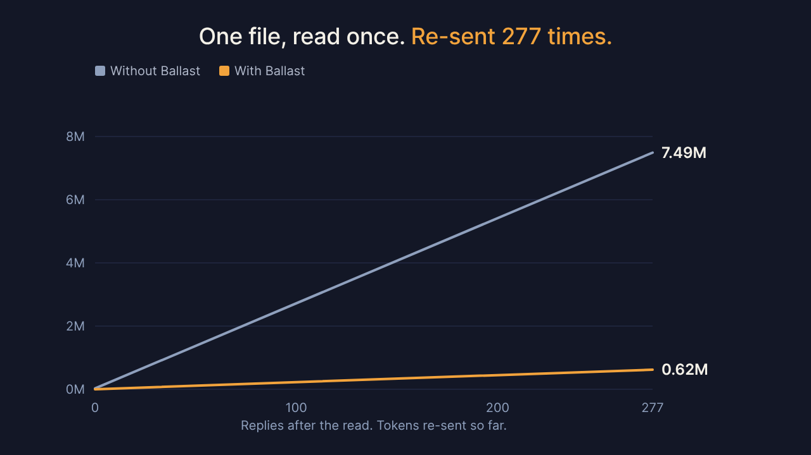
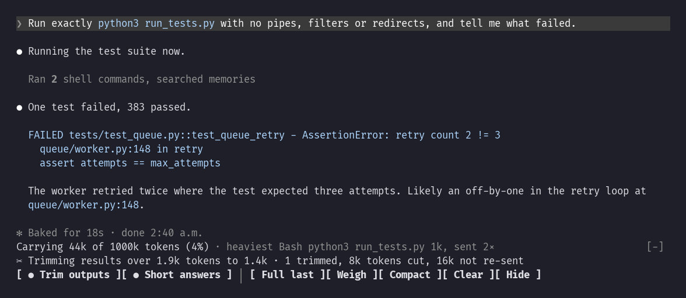
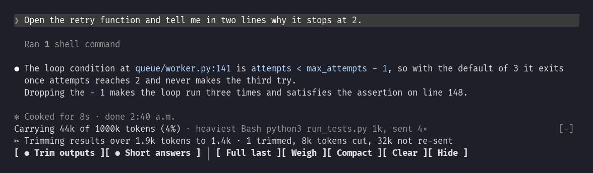
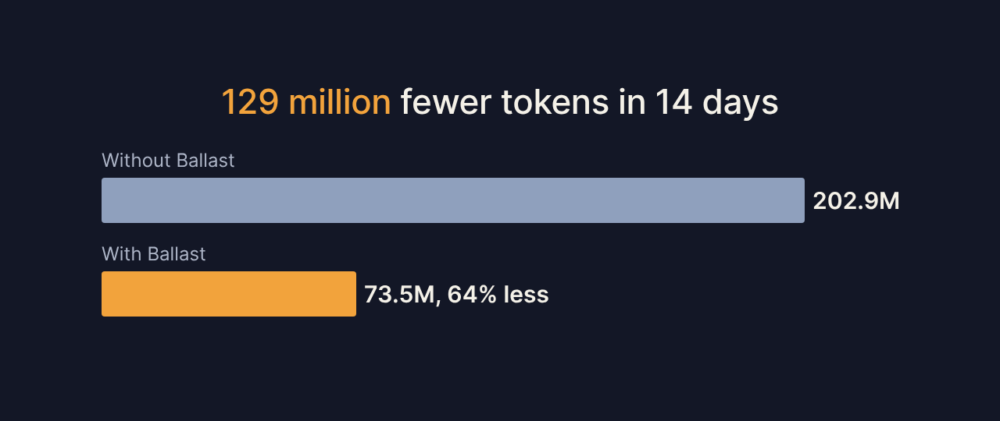
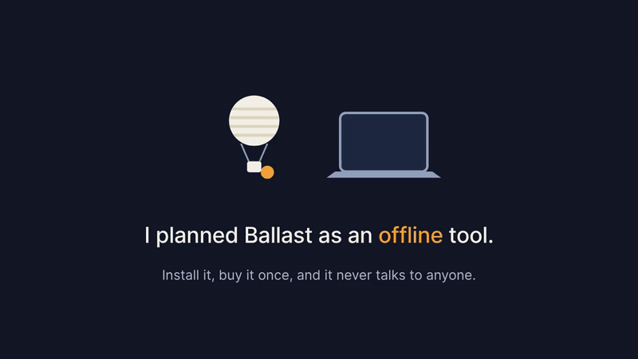

# Ballast

**Stop paying for the same test log on every reply.**

Ballast is a free plugin for Claude Code. Replayed over 14 days of my real sessions, it removes 129 million tokens, worth about $36 at Opus 5.5 API prices.

```
/plugin marketplace add TitasDas/ballast
/plugin install ballast@ballast
```


## Why

Claude rereads the whole conversation before every reply. A file you opened once keeps costing you until the conversation is cleared. In my sessions a large result typically gets re-sent 45 times. The worst was 277.



## How

Ballast cuts long results before Claude reads them. Failures stay in, with their file and line. The rest goes to a file in `.trimmed/` that Claude can read back if it needs to. The fuller the conversation gets, the tighter the cut, and Claude's replies get shorter too.

A test run that printed 400 lines. Claude got the failure, and the bar shows what the cut has saved:



The next question. The saving doubles without you doing anything:



## What it saves



| If you paid API prices for | 14 days | 30 days at this pace |
|---|---|---|
| Sonnet 5.5 | $18 | $38 |
| Opus 5.5 | $36 | $76 |
| Fable 5.1 | $57 | $121 |

These are my own 7,563 Claude requests, replayed through Ballast's cut and priced as if every one used that model. Re-sent tokens are billed at the cheap cached rate, so the dollars look small next to the token count: about 6% of the bill. The figures leave out shorter replies, and they leave out any saved file Claude reads back.

The bar shows your own numbers as you work.

## Controls

| Button | What it does |
|---|---|
| Trim outputs | Turns the cut on or off. |
| Short answers | Turns shorter replies on or off. |
| Full last | Shows the full version of the last cut output. |
| Weigh | Tells you whether the conversation needs a tidy up. |
| Compact | Shrinks the conversation and keeps what matters. |
| Clear | Starts fresh. |
| Hide | Folds the bar away. |

`/trim off` and `/lean off` do the same as the first two buttons.

## Your data, and why paid versions need an account



The Claude Code plugin is free and needs no account. It makes no network calls of its own.

I first planned Ballast as an offline tool, with paid versions unlocked by a key. When I started shipping paid features, I saw that an account was the easiest and most secure path, so I dropped the offline promise for paid versions. Paid versions for other coding agents will need you to sign in. They aren't on sale yet.

I don't collect your work. Your code and your conversations never reach me, and Ballast has no analytics. An account holds only what selling needs: your email address and your purchases, including which devices use them. Razorpay takes your card details, so I never see them. Visiting the website is covered by its [privacy page](https://implantintelligence.com/privacy).

See [LICENSE](LICENSE) for the terms.
