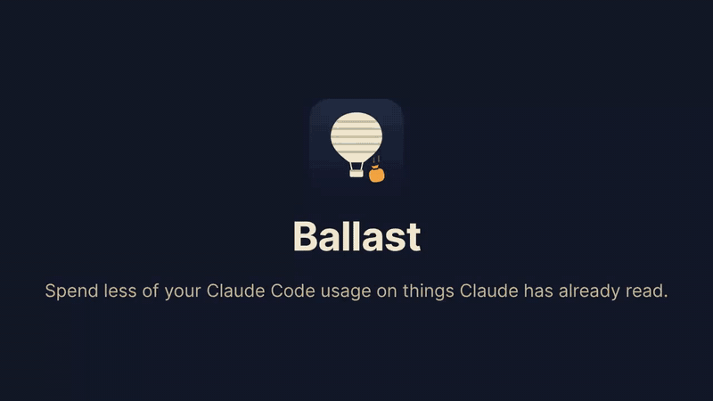

# Ballast

Spend less of your Claude Code usage on things Claude has already read.



## What it does

Long command output, like test runs and build logs, gets shortened to the parts that matter before Claude reads it. You can still see the full version whenever you want.

Claude's replies get shorter and more direct.

A small bar above where you type shows how much your conversation is carrying, and tells you when it's time to tidy up.

## Why it helps

Claude rereads the whole conversation every time it replies. A long test log you ran once keeps costing you on every reply after it, and uses up your limits faster.

## How much it saves

Over six days of my own work, long command output cost 14.7 million tokens across all the replies that followed it. With Ballast it would have been 7 million, about half.

## How to use it

Install it and work as usual. The bar above the prompt has these buttons:

| Button | What it does |
|---|---|
| Trim outputs | Turns the shortening on or off. Turn it off when you want every line. |
| Short answers | Turns shorter replies on or off. |
| Full last | Shows the full version of the last shortened output. |
| Weigh | Tells you whether your conversation is fine or needs a tidy up. |
| Compact | Shrinks the conversation but keeps what matters. |
| Clear | Starts fresh. Best when you move on to something unrelated. |
| Hide | Folds the bar away. |

## Install

In Claude Code, in a terminal, type:

```
/plugin install ballast --marketplace TitasDas/ballast
```

Type `y` when asked, then choose the user option. Ballast then works in every Claude Code session on your computer, VS Code included.

## Other coding agents

There's a paid version of Ballast for Codex, Gemini CLI and OpenCode. It shortens long command output and asks for shorter answers, just like it does here. For Cursor, Aider and other agents it comes as a set of rules plus a small command that does the shortening.

Ballast for Claude Code is free to use. See [LICENSE](LICENSE).
