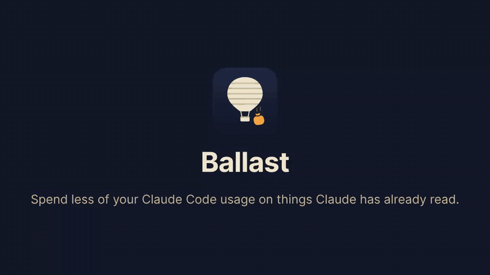
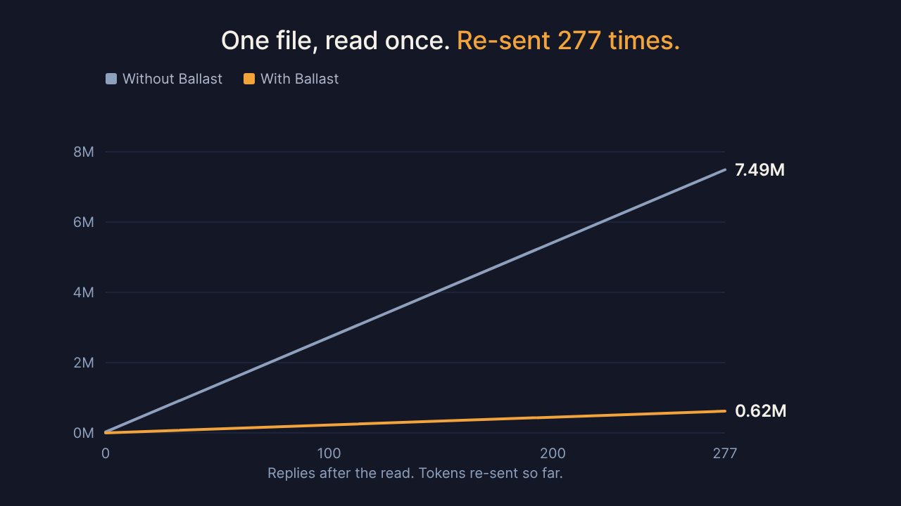
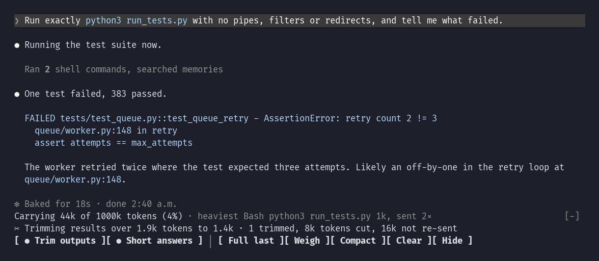
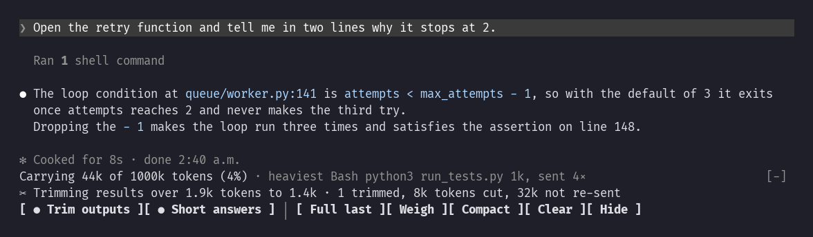
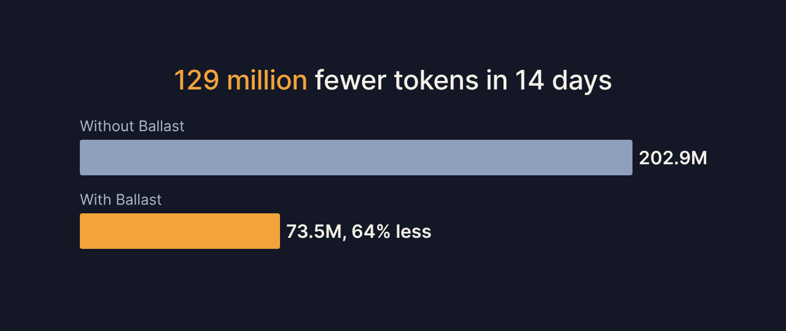

# Ballast

**Stop paying for the same tokens or words on every reply.**

Ballast is a plugin for Claude Code. It trims long outputs from tools in a conversation. The same log or context is not sent back with every message. Over 14 days of my own sessions it removed **129 million tokens**. That is about 6% of the bill, or $36 at Opus 5.5 API prices.

Needs Claude Code 2.1.310 or newer and a free Ballast account. The plugin hooks it uses are in early access.



## Get it

1. Sign in at https://ballast-accounts.implantintelligence.workers.dev with your email address. You get a link to click. There is no password.
2. Your account page shows the commands to add and install Ballast. Run them in a terminal. They look like this:

   ```
   claude plugin marketplace add <your address>
   claude plugin install ballast@ballast-account
   ```

   The address is yours alone, so keep it private. If it leaks, reset it on your account page.
3. Start Claude Code and type `/link`. It shows a code. Enter that code on your account page.

To update later, run these two and restart Claude Code:

```
claude plugin marketplace update ballast-account
claude plugin update ballast@ballast-account
```

If you have Ballast 0.3 or older, remove it first:

```
claude plugin uninstall ballast@ballast
claude plugin marketplace remove ballast
```

## Why use Ballast?

Claude rereads the whole conversation before every reply and we end up paying for those tokens. Since I dislike wastage in all forms, I made this to make that loop of my workflow a little more efficient. A cleverer version would keep a running estimate of what Claude still needs from each result, the way a Bayesian filter updates a belief, and then trim against that. Ballast does not do that yet.

The thing I saw most in my own sessions was a test log that was meant to be read once, being sent again and again with every message until I cleared the conversation. A large result was re-sent **45 times** on average. The worst case was **277 times**.



## How does Ballast work?

When a tool prints a long result, Ballast keeps the failures, with their file and line, and drops the rest. The full output is saved to a file inside the plugin folder, with passwords and keys masked, and Claude can read it back if it needs the detail. As the conversation fills up, the trimming gets tighter and Claude's replies get shorter.

Here a test run printed 400 lines. Claude saw the one failure, and the bar shows what the trim has saved so far:



On the next question the saving doubles, because the trimmed result is what gets re-sent:



## What it saves



| At API prices for | 14 days | 30 days at this pace |
|---|---|---|
| Sonnet 5.5 | $18 | $38 |
| Opus 5.5 | $36 | $76 |
| Fable 5.1 | $57 | $121 |

These are my own 7,563 requests over 14 days, replayed through an earlier version of Ballast and priced as if every one used that model. Re-sent tokens are billed at the cached rate, which is much cheaper, so the dollars look small next to the token count. The figures leave out shorter replies, and they leave out any saved file Claude reads back.

The bar shows your own numbers as you work.

## Controls

| Button | What it does |
|---|---|
| Link | Links this computer to your account. Shows until you have linked. Same as `/link`. |
| Trim outputs | Turns trimming on or off. Same as `/trim on` and `/trim off`. |
| Short answers | Turns shorter replies on or off. Same as `/lean on` and `/lean off`. |
| Full last | Shows the full version of the last trimmed output. |
| Weigh | Tells you whether the conversation needs a tidy up. Same as `/weigh`. |
| Compact | Shrinks the conversation and keeps what matters. Ballast first writes down the goal, the decisions and the next step with one extra request, and the summary is told to keep them. |
| Clear | Saves that same state with one extra request, then starts fresh. |
| Resume | Shows up at the start of the next session in the same project, and puts the saved state in the prompt box. |
| Hide | Folds the bar away. |
| Help | Explains every line and button in the bar. `/ballast` prints the same text. |

The extra request is billed like any other. It is cheap while the conversation is still cached and costs more after a long pause. It only runs when you press Compact or Clear, and only once the conversation is large enough to be worth it. The saved state stays on your disk.

The bar also keeps a loss check: how many cuts were later read back. A read-back means the cut dropped something the model needed, and the count is what tunes the budget. Flipping Short answers mid-session rewrites the system prompt and rebuilds the cached prefix; the bar says what that costs before the next request.

## On a company (Team or Enterprise) login

Some company settings switch off parts of a personal plugin. If that happens, the bar shows a line starting with a warning sign and a short message appears each turn. It means Short answers is not reaching Claude the normal way. Ballast tries to send the same rules another way, which works less well. Trimming and the bar still work.

To fix it, ask the person who manages Claude at your company to add Ballast to your organization's managed Claude Code settings, so it is no longer treated as a personal plugin. Until then you don't need to do anything.

To remove it, run `/plugin uninstall ballast@ballast-account`.

## Privacy

Your code and your conversations stay on your computer. Ballast never sends:

- your commands or their output
- file names
- your prompts

It does need an account, and it does talk to my server. About once a day it sends:

- how many results it saw, by kind of result
- how many of those it trimmed, and about how many tokens that left out
- how many trimmed results Claude went back to read
- the plugin version
- a random id and secret for this computer, so the server knows which one is asking

I use those counts to tune how much Ballast keeps. The account holds your email address. Each account works on one computer, and linking another replaces the first.

Once a day Ballast also reads one small file, `version.json`, from this repository, to see whether a newer version is out. That request carries nothing about you or your work.

If Ballast cannot reach the server for three days, it pauses and results pass through untouched. It starts again once it can reach the server.

The one extra request to Claude is the saved state described above, sent the same way as your own messages.

Ballast is free for now. The website has its own [privacy page](https://implantintelligence.com/privacy).

See [LICENSE](LICENSE) for the terms.
